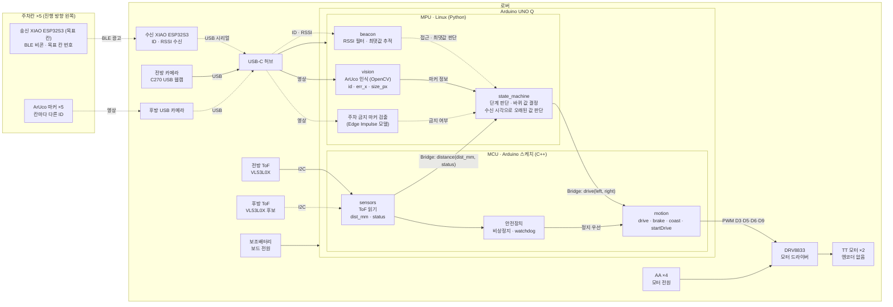

# 시스템 아키텍처

> **상태 (2026-11-10 기준):** 설계 초안입니다. 부품 주문 전이며 구현·검증된 것은 없습니다.
> 실선 = 현재 로버에 있거나 1주차 전반에 만들 부분, 점선 = 부품 도착 후(1주차 후반~) 또는 선택 기능.

## 역할 분리

| 위치 | 담당 | 이유 |
|---|---|---|
| MPU (Python) | 판단: 비콘·ArUco·거리 정보를 모아 단계를 정하고 바퀴 값을 결정 | 영상 처리처럼 무거운 계산과 전체 흐름 관리 |
| MCU (C++) | 실행: 받은 바퀴 값으로 모터 구동, 거리 센서 읽기 | 빠르고 일정한 타이밍 |
| MCU 안전장치 | 비상정지, watchdog. Python 판단보다 항상 우선 | Python이 멈추거나 통신이 끊겨도 로버는 멈춰야 함 |

두 쪽은 [인터페이스 문서](interfaces.md)에 정의한 Bridge 메시지로만 연결합니다.

## 주차 배치와 센서 역할 (2026-11-10 결정)

- 주차칸 5개는 **진행 방향 왼쪽**에 둡니다.
- ArUco 마커는 **5개, 칸마다 다른 ID**로 각 칸 뒷벽에 붙입니다.
- 로버는 후진 주차를 하므로, 후면이 칸을 향하도록 **오른쪽(시계 방향)으로 회전**합니다.
- 회전은 정해진 각도가 아니라 **목표 ID 마커가 보이면 정지**합니다. 처음 자세가 비스듬해도 칸을 향할 수 있게 하기 위해서입니다.

| 센서 | 역할 |
|---|---|
| 비콘 | 목표 칸 번호를 알려주고, 달리는 동안 "이 근처다"를 판단 (대략적인 위치) |
| ArUco 마커 | 가까이에서 맞는 칸인지 ID로 확인하고 정렬 (정확한 위치) |
| 후방 ToF | 후진할 때 남은 거리로 감속·정지 |

비콘이 칸 하나를 정확히 구분하지 못하더라도 마커 ID가 나머지를 해결합니다.
엔코더가 없어 이동량은 시간으로 추정하므로([#9](https://github.com/yumina0616/Hyper-AutoPark-Rover/issues/9)), 정밀함이 필요한 회전·정렬·후진은 모두 센서 피드백으로 처리합니다.
상태 흐름은 [#7](https://github.com/yumina0616/Hyper-AutoPark-Rover/issues/7)에서 논의합니다.

## 하드웨어 출처

모터(TT 모터), DRV8833, 핀 배치, AA 배터리 4개, C270 웹캠, USB-C 허브는 이전 세미나 자료
[emjdp/hyper-q-rover](https://github.com/emjdp/hyper-q-rover) 1주차 슬라이드를 기준으로 했습니다.

## 확인되지 않은 연결

- 수신 XIAO → USB 시리얼 → UNO Q 연결은 아직 검증하지 않았습니다.
- 후방 카메라와 수신 보드까지 USB 허브에 꽂았을 때 포트 수와 전원이 충분한지 확인해야 합니다.
- 후방 ToF를 추가하면 전방 센서와 I2C 주소(`0x29`)가 겹칩니다. XSHUT 핀으로 주소를 바꾸는 처리가 필요합니다.
- App Lab의 객체 인식 기능과 OpenCV ArUco가 같은 카메라를 동시에 쓸 수 있는지 확인해야 합니다.
