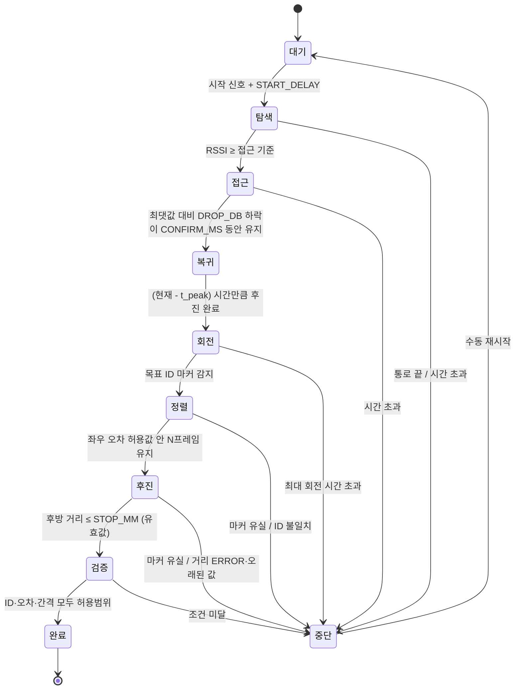

# 상태 기계 (State Machine)

> **상태 (2026-11-10 기준):** 논의용 초안입니다. [#7](https://github.com/yumina0616/Hyper-AutoPark-Rover/issues/7)에서 팀 리뷰 후 확정합니다.
> 코드는 2주차에 작성합니다. 임계값 숫자는 실험으로 정하므로 지금은 이름만 정하고 값은 `TODO`로 둡니다.

상태 기계는 로버가 지금 **어떤 단계에 있는지** 기억하고, 조건이 맞으면 다음 단계로 넘기는 총괄 프로그램입니다.
Python(MPU)에서 동작하며, 단계에 맞는 바퀴 값을 `drive(left, right)`로 MCU에 보냅니다. ([인터페이스](interfaces.md))

## 상태 흐름

## 상태 목록 (10개)

| # | 상태 | 하는 일 | 다음 상태로 넘어가는 조건 | 실패하거나 이상할 때 |
|---|---|---|---|---|
| 0 | **대기** `IDLE` | 정지, 시작 신호를 기다림 | 시작 신호 후 `START_DELAY`(3초) → 탐색 | – |
| 1 | **탐색** `SEARCH` | 통로를 직진하며 목표 비콘의 RSSI 수집 | 필터링한 RSSI ≥ `APPROACH_RSSI` → 접근 | 통로 끝 / `SEARCH_TIMEOUT` → 중단 |
| 2 | **접근** `APPROACH` | 감속하고, RSSI 최댓값과 그 시각 `t_peak`를 계속 기록 | 최댓값보다 `DROP_DB` 이상 낮은 상태가 `CONFIRM_MS` 동안 유지 → 복귀 | `APPROACH_TIMEOUT` → 중단 |
| 3 | **복귀** `RETURN` | 같은 속도로 `(현재 - t_peak)` 시간만큼 후진 | 후진 시간 완료 → 회전 | – |
| 4 | **회전** `TURN` | 오른쪽(시계)으로 연속 회전 | **목표 ID** 마커 감지 → 정렬 | `TURN_MAX_MS` 초과 → 중단 |
| 5 | **정렬** `ALIGN` | 후방 카메라 `err_x`로 좌우 보정 (P제어) | `|err_x| < ALIGN_TOL`가 `ALIGN_FRAMES` 프레임 연속 → 후진 | 마커를 `HOLD_SEC` 넘게 못 봄 / ID 불일치 → 중단 |
| 6 | **후진** `REVERSE` | 저속 후진하며 `err_x` 보정 유지, 거리에 따라 감속 | 후방 거리 `status=OK`이고 `≤ STOP_MM` → 검증 | 마커 유실 / 거리 `ERROR` / 오래된 값 → 중단 |
| 7 | **검증** `VERIFY` | 정지 후 결과 확인 | ID 일치, `|err_x|`, 후방 간격 모두 허용범위 → 완료 | 조건 미달 → 중단 |
| 8 | **완료** `DONE` | 정지, 결과 기록 | – | – |
| 9 | **중단** `ABORT` | 급정지, 이유 출력 | 수동 재시작 → 대기 | – |

## 모든 상태에 공통으로 적용하는 규칙

- **MCU 안전장치** (상태와 관계없이 항상): 비상정지 `EMERGENCY_MM`, watchdog `WATCHDOG_MS`
- **Python 공통 중단 조건**: 전체 시간 초과 `TOTAL_TIMEOUT`, 거리 `status=ERROR`, `STALE_SEC` 넘게 새 거리값 없음
- **로그**: 상태가 바뀔 때마다 `STATE,시각,이전,다음,이유`를 출력. 실험 기록에 그대로 사용

## 설계 배경

- **회전은 마커가 보이면 정지**: 처음 자세가 비스듬하면 정확히 90°를 돌아도 칸을 향하지 않습니다. 엔코더가 없어 각도도 정확히 잴 수 없으므로, 목표 마커가 보이는 것을 기준으로 멈춥니다.
- **복귀 단계**: RSSI 최댓값은 지나친 뒤에야 알 수 있습니다. 확실히 지나쳤는지 확인한 뒤 되돌아갑니다. 필터 지연 때문에 최댓값이 실제보다 늦게 잡힐 수 있어 보정이 필요할 수 있습니다.
- **비콘은 대략적인 위치, 마커는 정확한 칸**: 비콘이 반 칸 정도 틀려도 회전 후 목표 ID 마커가 보이면 성공합니다. 회전 중 다른 ID 마커는 무시합니다.
- **후진할 때 보정 부호**: 후진할 때는 바퀴 속도 차이에 따른 방향 변화가 전진과 반대입니다.

## 테스트용 시작 지점

2주차 전반에는 로버를 목표 칸 앞에 손으로 놓고 후진 주차를 개발합니다. 이를 위해 **정렬 상태에서 바로 시작**하는 옵션을 둡니다. 비콘이 준비되기 전에도 정렬~완료 단계를 테스트할 수 있습니다.

## 상태별로 필요한 모듈 출력

| 상태 | 필요한 값 | 담당 모듈 |
|---|---|---|
| 탐색·접근 | 목표 비콘의 필터링된 RSSI, 수신 시각 | beacon |
| 복귀 | 주행 시간 | motion, `Odometry` |
| 회전 | 연속 회전 `spin` ([#8](https://github.com/yumina0616/Hyper-AutoPark-Rover/issues/8)) | motion |
| 회전·정렬·후진·검증 | `id`, `err_x`, `size_px`, 검출 시각 | vision |
| 후진·검증 | `dist_mm`, `status`, 수신 시각 | sensors |

## 임계값 이름 (값은 실험으로 결정)

| 이름 | 쓰이는 곳 | 초기값 |
|---|---|---|
| `START_DELAY` | 대기 | `3.0`초 |
| `APPROACH_RSSI` | 탐색 → 접근 | `TODO` |
| `DROP_DB`, `CONFIRM_MS` | 접근 → 복귀 | `TODO` |
| `TURN_MAX_MS` | 회전 | `TODO` (약 150°에 해당하는 시간) |
| `ALIGN_TOL`, `ALIGN_FRAMES` | 정렬 → 후진 | `TODO` |
| `HOLD_SEC` | 정렬·후진 마커 유실 판단 | `0.5`초 (이전 코드) |
| `STOP_MM` | 후진 → 검증 | `TODO` (이전 코드는 150~200) |
| `SEARCH_TIMEOUT`, `APPROACH_TIMEOUT`, `TOTAL_TIMEOUT` | 시간 초과 | `TODO` |

## 논의할 것

- [ ] 상태 개수와 이름 확정
- [ ] 시작 신호 (버튼 / 웹 화면 / 앱 실행 즉시)
- [ ] 정렬 완료 조건의 허용값과 프레임 수
- [ ] 중단 대신 재시도할 상황 (예: 정렬 중 마커 유실 → 작게 회전하며 재탐색)
- [ ] 각 시간 초과 값
- [ ] 잘못된 ID가 보였을 때 몇 칸 차이인지 계산해 보정할지 (확장 기능)
